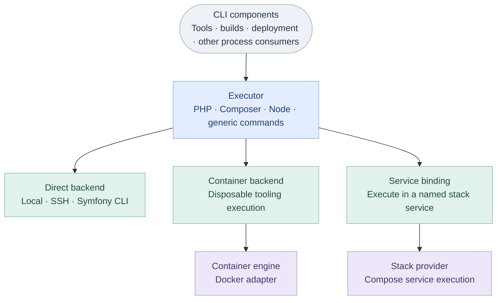
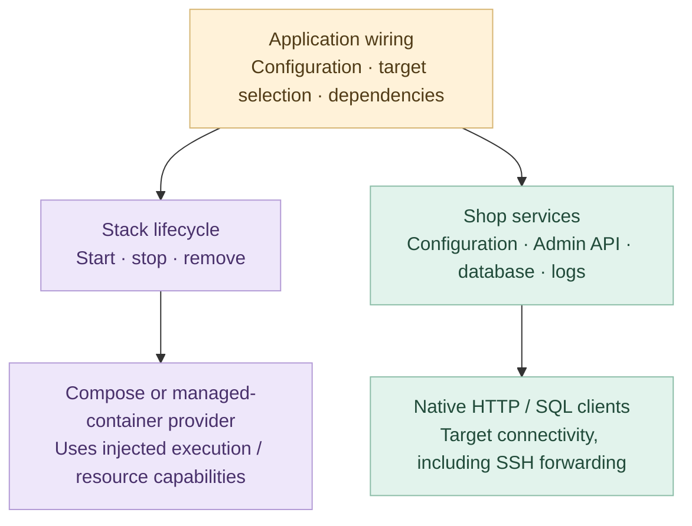

- Related: [Issue #1713](https://github.com/shopware/shopware-cli/issues/1713),
  [Issue #1672](https://github.com/shopware/shopware-cli/issues/1672),
  [Issue #1534](https://github.com/shopware/shopware-cli/issues/1534)
- Related: [Containerized QA execution](2026-11-11-containerized-qa.md)

## Context

External process execution is scattered throughout Shopware CLI. Consumers use
`exec.Command`, `exec.CommandContext`, Docker and Compose invocations, or the
existing executor to run programs locally, inside containers and over SSH.
Improving stream handling, cancellation or runtime support requires changes
across consumers. The existing executor also mixes process execution with shop
configuration, Admin API clients, database connections and log access.

The requirement to run QA tools in containers adds another execution target to
these workflows. QA should work without depending on host PHP and Node.js
installations, with consistent tooling across development and CI.
[Containerized QA execution](2026-11-11-containerized-qa.md) describes that
first application of the shared model.

Implementing this through more command-specific Docker calls would spread
execution logic further across the CLI. A shared execution boundary instead
allows tools and other consumers to describe their workloads independently of
the selected environment. QA offers a concrete starting point for establishing
that contract, so later stack and deployment work can reuse process handling
rather than introduce further execution paths.

The scope therefore extends beyond containerized QA to separating process
execution from shop-domain services. Adoption starts with QA and proceeds in
independently verified stages, preserving existing stack, proxy and SSH behavior
until their replacements are ready.

## Decision

Adopt shared executor and runtime contracts as the boundary for external process
execution across the CLI. Group the implementations under
`internal/orchestration`. Introduce the model through local and containerized
QA, then migrate other consumers in independently reviewable stages.

### Architecture

| Component | Responsibility |
| --- | --- |
| Application wiring | Resolve configuration and tooling, select targets and supply adapters. |
| `orchestration/executor` | Build generic and ecosystem-specific commands and provide execution and capture conveniences. |
| `orchestration/runtime` | Define command, process and result contracts, with local, container and later SSH adapters. Own workspace path mapping. |
| `orchestration/container` | Define disposable execution and persistent resource capabilities, with Docker as the first engine adapter. |
| `orchestration/stack` | Define lifecycle and service-execution capabilities for providers such as Compose and proxy infrastructure. |
| Domain services | Own configuration, Admin API, database and log behavior. |

Application wiring selects and injects the execution target. Consumers use the
same executor API for each route:



Stack lifecycle and native client access are separate application concerns.
The stack provider above also exposes the lifecycle capabilities shown below:



The execution infrastructure lives under `internal/orchestration`, while shop
services remain in their domain packages. Application wiring supplies the
implementations, allowing consumers to depend on small contracts. The executor
uses the runtime contract for process execution, with a container backend
adapting an engine's runner to the same interface. Stack providers build on
injected execution and resource-management capabilities, keeping process
creation and engine-specific arguments within the concrete adapters.

Consumers retain their domain behavior, such as tool arguments, output parsing
and findings, while application wiring selects the execution target. The shared
execution boundary also provides a consistent place to instrument telemetry
for executor and runtime usage, durations and failures without duplicating
instrumentation across consumers.

### Orchestration API

The API defines the application-wide execution boundary. Its contracts cover
commands, execution targets and resource lifecycle. The
examples below show how different consumers use that boundary. Implementing
all illustrated adapters is not a prerequisite for the first delivery.

#### Shared execution contract

Use one process contract across local execution, containers and SSH. Consumers
describe workloads in the target environment, while adapters own Docker
arguments, SSH quoting and Compose service selection:

```go
// orchestration/runtime
type Command struct {
    Name string            // Executable name or path in the target environment.
    Args []string          // Arguments passed without shell parsing.
    Dir  string            // Command's working directory (CWD) in the target.
    Env  map[string]string // Overrides for the target's inherited environment.
}

type Backend interface {
    Start(context.Context, Command, Options) (Process, error)
}

type Process interface {
    Wait() (Result, error)
    Stop(context.Context) error
}

type Options struct {
    Stdin   io.Reader   // Process input; nil supplies no input.
    Stdout  io.Writer   // Receives stdout as produced; nil discards it.
    Stderr  io.Writer   // Receives stderr as produced; nil discards it.
    Capture CaptureMode // Configures output buffering; defaults to CaptureNone.
    TTY     bool        // Requests a terminal when supported by the backend.
}

type CaptureMode uint8

const (
    CaptureNone CaptureMode = iota // Do not buffer output (default).
    CaptureSeparate                // Buffer stdout and stderr separately.
    CaptureCombined                // Buffer both streams in observed write order.
)
```

`Dir` sets the command's working directory (CWD) in the selected execution
environment. For containers, application wiring maps the chosen host directory
to its container path before setting `Dir`, as described under
[Target wiring and workspace](#target-wiring-and-workspace).

Use `Stdout` and `Stderr` in `Options` to stream output while the command runs.
Set `Options.Capture` to retain output in `Result.Output` after completion.
Streaming and capture can be used together. By default, output is not buffered.
With neither configured, output is discarded. Both streaming and buffered
output follow the same contract across all backends.

`Command` describes an invocation without implicit shell parsing. `Start`
begins execution and returns a `Process` handle. The backend owns process
reaping and cleanup of execution-owned resources, even if nobody calls `Wait`.
The execution context controls the workload lifetime after startup. Caller-owned
streams must remain usable until execution completes, and blocked I/O can delay
finalization.

`Wait` observes completion, including cleanup, and returns the recorded outcome.
Call it directly to block, or in a goroutine to receive the outcome
asynchronously. Multiple callers observe the same completion without repeating
execution or cleanup. Callers should observe the outcome to handle failures.

`Stop` requests forceful termination even if its context is canceled. Its
context bounds waiting for finalization, while termination and cleanup continue
independently. A later `Wait` still returns the completed outcome.

`Wait` returns the workload outcome in a shared result type, including available
output even when execution fails:

```go
type Result struct {
    ExitCode int
    Output   CapturedOutput
    Usage    *ResourceUsage
}

type CapturedOutput struct {
    Mode     CaptureMode
    Stdout   []byte
    Stderr   []byte
    Combined []byte
}
```

`ExitCode` is the workload status, or -1 when unknown. `Usage` contains resource
measurements when the backend can provide them and is otherwise nil. Capture
is opt-in. `CaptureMode` selects no capture, separate stdout and stderr, or
combined output in observed write order. Only the selected representation is
populated, with captured bytes retained independently of the caller's streams.

Keep workload exits distinct from startup, transport and cleanup failures.
Consumers interpret program-specific exits, such as ESLint reporting source
violations. A matching engine or SSH client exit code does not establish a tool
finding. Preserve transport ambiguity rather than inventing a workload result.

#### Executor API

The executor provides command construction, defaults and lifecycle conveniences
above `runtime.Backend`. PHP and Node helpers build ordinary commands, so
specialized and generic calls share stream, capture and error handling. They do
not install tools or choose an environment.

For example, a consumer receives an executor and runs Composer without knowing
whether it targets the host, a container or a stack service:

```go
func installDependencies(ctx context.Context, executor *executor.Executor,
    streams runtime.Options,
) error {
    _, err := executor.PHP().
        Composer("install", "--no-interaction").
        Run(ctx, streams)
    return err
}
```

Node and generic commands use the same shape, as these independent examples
show:

```go
_, err := executor.Node().NPM("run", "build").Run(ctx, streams)

result, err := executor.Command("git", "rev-parse", "HEAD").Capture(ctx)
```

`Run` starts and waits. `Start` returns the process handle for asynchronous
work. `Capture` and `CombinedOutput` provide the two capture modes. Executor
defaults and per-command overrides return copies, allowing consumers to vary a
directory or environment without changing shared settings.

#### Target wiring and workspace

Resolve execution policy in application wiring and inject the selected backend.
A local executor uses the project or extension directory as its default:

```go
executor := executor.New(local.New()).WithDir(workspaceRoot)
```

A disposable container exposes the same backend contract. The container package
supplies structured image, mount and user settings, while the runtime adapter
binds those settings to command execution:

```go
engine := containerdocker.New()
backend := containerruntime.New(engine, container.RunOptions{
    Image: workloadImage,
    Mounts: []container.Mount{
        {Source: workspaceRoot, Target: "/workspace"},
    },
    User: containerUser,
})
executor := executor.New(backend).WithDir("/workspace")
```

Here `containerdocker` and `containerruntime` alias the engine and container
runtime packages. The engine implements the following capability:

```go
// orchestration/container
type Runner interface {
    Run(context.Context, RunOptions, runtime.Command, runtime.Options) (runtime.Process, error)
}
```

The container runtime delegates `Backend.Start` to `Runner.Run`. The Docker
adapter owns engine arguments and disposable-resource cleanup. Another engine
can implement `Runner` without changing the executor or tool implementations.
Selecting a backend does not install tools or copy source files. For example,
running PHP in a container requires an image containing PHP and a mount that
makes the source files available inside it.

Selection is per use case. One CLI invocation may use containerized QA and a
host executor for certificate setup. A command requiring the running Shopware
can receive a service-bound executor instead. To move a consumer from local to
container execution, application wiring supplies a different backend and sets
up its tools and files. The consumer's command construction and result handling
remain the same, provided it uses the supplied executor throughout.

Use one workspace mapping to relate host paths to paths inside the target. In
the example above, `workspaceRoot/src/Example.php` becomes
`/workspace/src/Example.php`. Use this mapping when setting working directories
and passing file paths to tools. After parsing tool output, convert paths in
findings back to the user's source paths before reporting them. Command
arguments and raw output are not automatically searched and rewritten.

#### Stack lifecycle and service execution

A stack manages resources beyond one command. Give lifecycle and service
execution separate capabilities rather than expanding the process backend.
Compose is the first development-stack provider. Other providers can manage
containers directly through engine capabilities. Providers expose the
capabilities they support:

```go
package stack

type Lifecycle interface {
    Start(context.Context, runtime.Options) (runtime.Result, error)
    Stop(context.Context, runtime.Options) (runtime.Result, error)
}

type ServiceExecutor interface {
    Exec(context.Context, string, runtime.Command, runtime.Options) (runtime.Process, error)
}

type Remover interface {
    Remove(context.Context, RemoveOptions, runtime.Options) (runtime.Result, error)
}
```

For example, a Compose provider uses an injected backend to run its management
commands. Application wiring explicitly starts the stack and binds an executor
to its web service, where PHP, Node and generic commands use the same API as
local execution:

```go
provider, err := compose.New(local.New(), compose.Options{
    Directory:   projectRoot,
    ProjectName: projectName,
})
if err != nil {
    return err
}
if _, err := provider.Start(ctx, streams); err != nil {
    return err
}

executor := executor.New(stack.Service(provider, "web")).WithDir("/var/www/html")
_, err = executor.PHP().Console("cache:clear").Run(ctx, streams)
```

`stack.Service` implements `runtime.Backend` by calling the provider's `Exec`.
The command follows executor → service binding → provider, with the provider
using the shared execution machinery for its Compose invocation. Compose flags
and service selection stay in the provider. The executor imports no concrete
stack implementation, and executing a command never implicitly starts a stack.

`Stop` retains stack resources. `Remove` tears down the provider's resources,
with volume removal requested explicitly through `RemoveOptions`. Existing CLI
commands retain their established behavior during migration, even where their
user-facing names differ from these internal operations.

#### Persistent infrastructure and engine capabilities

Persistent services use engine capabilities separate from the disposable
`Runner`. Stack providers use `container.Lifecycle` to manage individual
containers and `container.Networks` to manage shared networks:

```go
package container

type Lifecycle interface {
    Inspect(context.Context, string) (State, error)
    Create(context.Context, CreateOptions) (string, error)
    Start(context.Context, string) error
    Stop(context.Context, string) error
    Restart(context.Context, string) error
    Remove(context.Context, string) error
}

type Networks interface {
    EnsureNetwork(context.Context, string) error
    RemoveNetwork(context.Context, string) error
}
```

`CreateOptions` describes the container's name, image, arguments, mounts, ports,
network and restart policy. `State` reports its identity, running state and
labels. Engine adapters implement the operations, while stack providers decide
which resources to create, reuse or replace.

For example, an `InfrastructureStack` provider could manage the shared proxy and
DNS containers without Compose. It holds the engine capabilities and the
configuration needed to manage those services:

```go
// Application provider in the proxy package.
type InfrastructureStack struct {
    containers container.Lifecycle
    networks   container.Networks
    options    InfrastructureOptions
}

type InfrastructureOptions struct {
    Directory  string
    BaseDomain string
}

func (s *InfrastructureStack) Start(ctx context.Context, _ runtime.Options) (runtime.Result, error) {
    if err := s.startTraefik(ctx); err != nil {
        return runtime.Result{ExitCode: -1}, err
    }
    if err := s.startDNS(ctx); err != nil {
        return runtime.Result{ExitCode: -1}, err
    }
    return runtime.Result{ExitCode: 0}, nil
}
```

In this sketch, `startTraefik` and `startDNS` prepare configuration and use the
injected engine capabilities to ensure the network and containers are ready.

Application wiring supplies an engine implementing both capabilities:

```go
engine := containerdocker.New()
provider, err := proxy.NewInfrastructureStack(engine, engine,
    proxy.InfrastructureOptions{
        Directory:  stateDirectory,
        BaseDomain: baseDomain,
    })
if err != nil {
    return err
}
_, err = provider.Start(ctx, runtime.Options{})
```

The same engine supplies both container capabilities. The provider would expose
`stack.Lifecycle` and `stack.Remover` to its consumers. Consumers use the same
stack API as Compose, without needing service execution or engine-specific
calls. `Stop` retains resources, while `Remove` applies the provider's retention
policy. The services outlive each management call.

These contracts also allow a reusable managed-stack provider later. Supporting
another engine requires implementations of the container and network
capabilities used by the provider. Proxy discovery and socket configuration may
also need engine-specific adjustments. The initial proxy migration can use a
custom stack provider following the example above.

#### Shop services and SSH

Move configuration loading, log access, Admin API integration and database
connection management out of the old executor into the components responsible
for those domains. API clients own request and response handling, while database
services own connection configuration and sessions. Application wiring supplies
the credentials, endpoints and connectivity for the selected environment. The
exact package layout remains open, while the executor focuses on external
processes.

| Use case | Execution boundary |
| --- | --- |
| Run a console command or Composer | Supplied executor and runtime backend. |
| Read shop configuration or locate logs | Shop-domain service, using process execution only when needed to access the target. |
| Call the Admin API | Native HTTP client with resolved credentials and endpoint. |
| Dump a database through the SQL driver | Database service with a direct or forwarded connection. |
| Execute deployment PHP or an external transfer client | Executor with the SSH backend, plus deployment or transfer policy in the consumer. |

SSH illustrates how these responsibilities work together. Deployment uses the
executor for remote processes, while database access uses a separate connection.
For the process side, deployment can run a prepared PHP script and supply its
JSON input through the same command and stream API:

```go
executor := executor.New(ssh.New(local.New(), ssh.Options{
    Host: host,
    User: user,
})).WithDir(remoteDirectory)

result, err := executor.PHP().Run("-r", phpCode).
    Run(ctx, runtime.Options{
        Stdin:   bytes.NewReader(payload),
        Capture: runtime.CaptureSeparate,
    })
```

Here `phpCode` is PHP code without an opening tag. The SSH adapter owns remote
quoting and stream forwarding. Deployment owns script preparation, filesystem
layout and Composer policy. Initialization before the remote directory exists
can override the command directory with `WithDir("")`.

Database forwarding is a connectivity capability, separate from starting a
process. The database layer can define the capability it needs:

```go
type Dialer interface {
    DialContext(context.Context, string, string) (net.Conn, error)
}
```

An optional SSH helper can expose a dialer from the same transport used for
remote commands. Database setup then receives that dialer. An illustrative API
could look as follows:

```go
dialer, err := executor.SSH().Dialer()
if err != nil {
    return err
}
connection, cleanup, err := databaseConfig.Open(ctx, dialer)
if err != nil {
    return err
}
defer cleanup()
```

Application wiring owns the shared SSH transport. The database integration
closes its forwarded connection, while the transport manages forwarding and
connection reuse. Canceling a dial attempt must not end an established
connection. The helper API remains open and does not enlarge `runtime.Backend`.

### Testability

The runtime boundary provides a small substitution point for consumer tests.
A test backend receives the command and streams, supplies fixture output and
returns a controllable process result. Tests retain the real executor,
capture and consumer logic without requiring installed runtimes or fake
executables on `PATH`.

Consumer tests can verify command construction, output interpretation and
partial failures independently of the execution target. Concurrent consumers
need concurrency-safe test doubles. Filesystem preparation and downloads still
require isolated fixtures or their own dependency boundaries.

| Test scope | Responsibility |
| --- | --- |
| Consumer with an injected backend | Arguments, output interpretation, findings and error handling. |
| Runtime and adapter contracts | Streams, process lifetime, cancellation, results and cleanup. |
| Native integration | Real tool behavior, container or remote execution, and persisted effects. |

Backend substitution makes consumer tests more focused. Native integration
tests remain necessary to verify the behavior each adapter promises.

### Staged migration

Introduce the shared API first, then use it for containerized QA. Migrate the
remaining parts of the CLI in small, separately reviewed PRs. Existing commands
keep their current implementation until the replacement is ready.

| Stage | Changes | Ready when |
| --- | --- | --- |
| 1. Foundation | Add executor and runtime contracts, local execution and disposable Docker execution. | The core works and is tested independently of stack, proxy and SSH support. |
| 2. QA | Adopt [containerized QA execution](2026-11-11-containerized-qa.md). | Findings, reports, exit codes and file changes match the existing workflow. |
| 3. Domain separation | Move configuration, Admin API, database and logs out of the old executor. | Existing environment selection and connections still work. |
| 4. Stack | Move Compose start, stop and removal, then commands inside services, to the shared API. | Stack names, retained resources and service commands behave as before. |
| 5. Proxy | Move proxy and DNS container management to a stack provider. Keep host configuration separate. | Startup, reuse, replacement, discovery and teardown work as expected. |
| 6. SSH | Migrate remote commands, deployment, file transfers and forwarded connections. | Required tooling, connection cleanup, cancellation and interactive commands are verified. |
| 7. Cleanup | Migrate remaining callers and remove the old executor and temporary migration code. | All callers use the new API. |

Each stage can span several PRs. QA can ship before stack, proxy or SSH support.
Add and test a backend before switching commands to it, then remove the old
implementation when it is no longer used.

Test each migrated workflow with real tools and isolated projects. Check
cancellation, cleanup, file changes and failures after only part of an operation
has completed. Interactive commands also need terminal and signal checks. A
failed command must not automatically run again through the old implementation,
since it may already have changed files or resources.

## Consequences

The CLI gains a common execution API for tools, builds, stack services and
remote commands. As consumers migrate, process construction and lifecycle
handling move out of individual workflows into reusable adapters. Improvements
to streams, cancellation, cleanup and error handling can then benefit every
consumer using the shared implementation. The same boundary supports consistent
telemetry for execution targets, durations and failures.

The small runtime contract improves testability. Consumer tests can supply
output and failures through an injected backend while exercising real command
construction and result handling. Adapter and integration tests verify process
and engine behavior separately, reducing the need to reproduce the execution
environment in every consumer test.

Separating process execution, stack management and domain services gives each
a clear responsibility. Additional container engines or execution targets can
extend the relevant capabilities, while consumers retain their command API.
Database and HTTP clients keep their native interfaces and can use target
connectivity independently of process execution.

These benefits can be delivered incrementally. QA does not have to wait for the
stack, proxy or SSH migration. The investment is shared adapter and wiring code,
plus temporary maintenance of old and new paths. Each backend still needs clear,
verified guarantees for termination, cleanup and status reporting. Removing old
implementations as migration progresses keeps that added complexity temporary.
