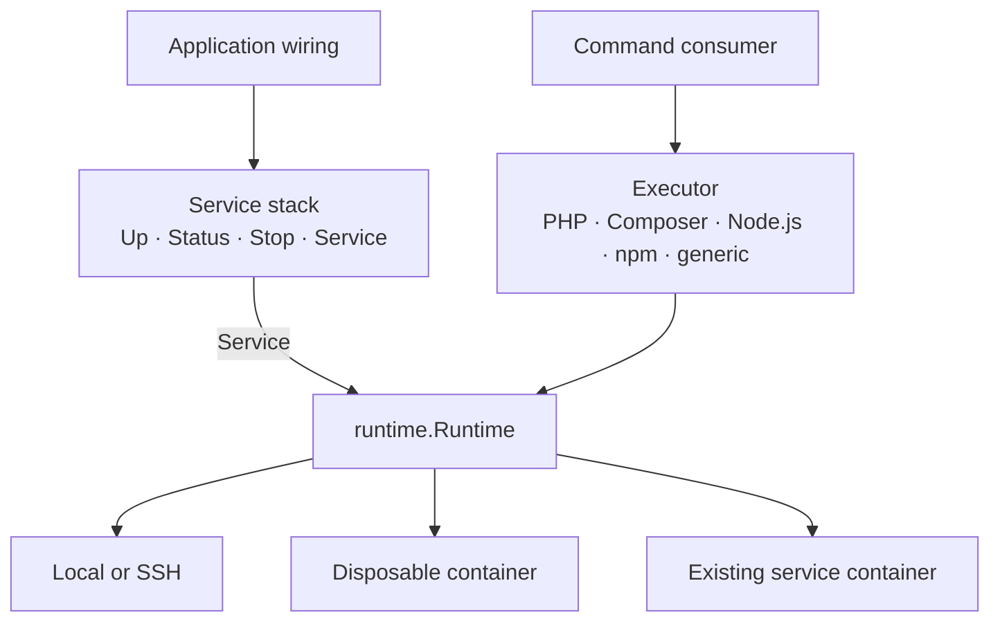
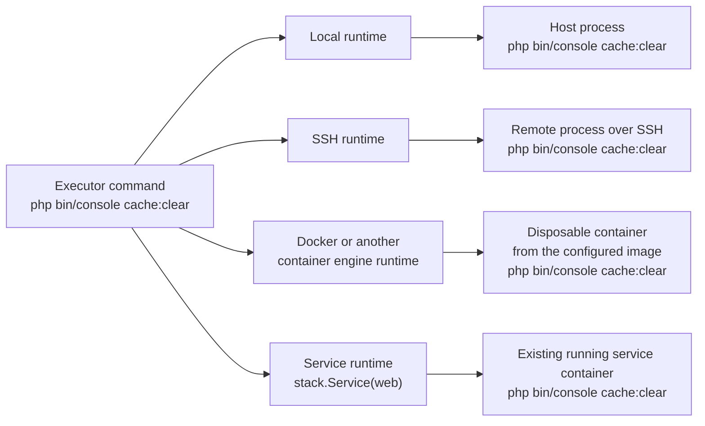

- Related: [Issue #1713](https://github.com/shopware/shopware-cli/issues/1713),
  [Issue #1672](https://github.com/shopware/shopware-cli/issues/1672),
  [Issue #1534](https://github.com/shopware/shopware-cli/issues/1534)
- Related: [Containerized QA execution](2026-11-11-containerized-qa.md)

## Context

External process execution is scattered throughout Shopware CLI. Consumers use
`exec.Command`, `exec.CommandContext`, Docker and Compose invocations, or the
existing executor to run programs locally, inside containers and over SSH.
Improving stream handling, cancellation or runtime support requires changes
across consumers. The existing executor also mixes process execution with shop
configuration, Admin API clients, database connections and log access.

The requirement to run QA tools in containers adds another execution target to
these workflows. QA should work without depending on host PHP and Node.js
installations, with consistent tooling across development and CI.
[Containerized QA execution](2026-11-11-containerized-qa.md) describes that
first application of the shared model.

Implementing this through more command-specific Docker calls would spread
execution logic further across the CLI. A shared execution boundary instead
allows tools and other consumers to describe their workloads independently of
the selected environment. QA offers a concrete starting point for establishing
that contract, so later stack and deployment work can reuse process handling
rather than introduce further execution paths.

The scope therefore extends beyond containerized QA to separating process
execution from shop-domain services. Adoption starts with QA and proceeds in
independently verified stages, preserving existing stack, proxy and SSH behavior
until their replacements are ready.

## Decision

Use shared execution and resource contracts under `internal/orchestration`.
Consumers run commands through an executor with an injected runtime. Runtime
implementations provide the capabilities they support. Service stacks own their
configuration and composition through a common lifecycle and service contract.
Introduce command execution and containerized QA first, then migrate the
remaining workflows in independently verified stages.

### Terms and responsibilities

| Term | Meaning |
| --- | --- |
| Executor | Command builder and runner. Provides PHP, Composer, Node.js, npm and generic commands, defaults and output capture. |
| Runtime | Runs commands locally, in containers or over SSH through the `runtime.Runtime` interface. A runtime can also offer container and network management. |
| Capability | An interface for related operations a runtime supports. For example, a consumer that manages persistent containers requires `runtime.Containers`. |
| Implementation | Code that implements a shared interface for a specific environment or container engine. |
| Service stack | A persistent group of named services with its own configuration and composition logic. Implements `runtime.ServiceStack`. |
| Application wiring | Configuration resolution, implementation selection and dependency construction before calling a consumer. |
| Workspace | A mapping between source paths on the host and paths in the selected execution environment. |

The `runtime` package defines the shared interfaces and data types.
Implementations such as `runtime/docker` import this package to use those
contracts. The `runtime` package does not import the implementations.
Application wiring creates the selected implementations and passes them to
consumers through these interfaces.

The following table shows the package structure under `internal` and the
responsibility of each package or domain component.

| Package or component | Responsibility |
| --- | --- |
| `orchestration/executor` | Command construction, execution conveniences and capture. |
| `orchestration/runtime` | Commands, streams, processes, results, workspace mapping, container and image capabilities and the service-stack contracts. |
| `orchestration/runtime/local`, `orchestration/runtime/docker`, later `orchestration/runtime/ssh` | Implement supported execution and resource capabilities. Local and SSH provide command execution. Docker also provides container and network management. |
| Shop-domain services | Configuration, logs, Admin API, database connections and target connectivity. |

The same command consumer works with a local, disposable-container, remote or
service runtime.



### Execution environments

Consumers describe ordinary commands such as `php bin/console cache:clear`.
They use the same executor API whether PHP runs on the host, on a remote host
or inside a container. The selected runtime determines where the command runs:



Each command runs as a normal process within its selected environment. Working
directories, environment variables and paths refer to that environment.
Disposable execution creates a container for the command and removes it after
completion. Service execution runs the command inside an existing container
and leaves that container running. Application wiring prepares the tools and
files needed in the selected environment.

A disposable command can also run a complete CLI workflow. For example, the
host CLI starts `shopware-cli project validate` in a tooling container, where
the inner CLI runs QA tools through its local executor. Running individual QA
tools directly in disposable containers is also possible. The choice belongs
to each workflow and can evolve without changing the execution contract.
[Containerized QA execution](2026-11-11-containerized-qa.md) initially wraps the
complete CLI command.

### Command execution

A runtime executes commands in the selected environment and passes their
arguments without implicit shell parsing. Each implementation handles the
details of its environment, including container-engine flags, SSH quoting and
stream forwarding.

The following types belong to `orchestration/runtime` and define the shared
contract used by the executor and runtime implementations.

```go
package runtime

type Command struct {
    Name string            // Executable in the target environment.
    Args []string          // Arguments without shell parsing.
    Dir  string            // Working directory in the target.
    Env  map[string]string // Overrides for the target environment.
}

type Runtime interface {
    // Start starts the command and returns its process handle.
    Start(context.Context, Command, Options) (Process, error)
}

type Options struct {
    Stdin   io.Reader   // Input to the command. Nil means no input.
    Stdout  io.Writer   // Streams stdout. Nil discards streamed output.
    Stderr  io.Writer   // Streams stderr. Nil discards streamed output.
    Capture CaptureMode // Selects the output retained in Result.Output.
    TTY     bool        // Requests a terminal when supported.
}

type CaptureMode uint8

const (
    CaptureNone CaptureMode = iota // Do not retain output (default).
    CaptureSeparate                // Retain stdout and stderr separately.
    CaptureCombined                // Merge both streams into one output.
)

type Process interface {
    // Wait observes completion, including output forwarding and cleanup.
    Wait() (Result, error)
    // Stop sends a graceful shutdown request.
    // The context can cancel communication with the runtime.
    // Use Wait to observe exit and cleanup.
    Stop(context.Context) error
    // Kill sends a forceful termination request.
    // The context can cancel communication with the runtime.
    // Use Wait to observe exit and cleanup.
    Kill(context.Context) error
}

type Result struct {
    ExitCode int            // Workload exit code, or -1 when unknown.
    Signal   string         // Name of the signal that ended the workload, such as SIGKILL.
    Output   CapturedOutput // Output retained according to Capture.
    Usage    *ResourceUsage // Workload resource usage. Nil when unavailable.
}

type ResourceUsage struct {
    CPUTime time.Duration // CPU time used by the workload.
}

type CapturedOutput struct {
    Mode     CaptureMode // Capture mode used for this execution.
    Stdout   []byte      // Retained stdout in separate mode.
    Stderr   []byte      // Retained stderr in separate mode.
    Combined []byte      // Retained stdout and stderr in combined mode.
}
```

`Start` starts the command and returns a process handle. Its context controls
execution lifetime, so cancellation requests forceful termination. `Wait`
returns after the command exits, output forwarding finishes and cleanup
completes. Repeated or concurrent calls observe the same result. The runtime
collects the process result and cleans up even if nobody calls `Wait`.

`Stop` sends a graceful shutdown request. `Kill` sends a forceful termination
request. On Unix these use `SIGTERM` and `SIGKILL` for local processes. Other
runtimes use the corresponding mechanism in their environment. Both methods
return after sending the termination request without waiting for command exit.
Their context can cancel communication with a container engine or remote host.
Local signaling normally returns immediately. An already canceled context
prevents sending the termination request. Cancellation during communication
does not guarantee that termination was prevented. If the command ignores
`Stop`, the caller can use `Kill`. There is no automatic escalation.

The local runtime starts each command in its own process group, so termination
also reaches the workers a command starts. The CLI cancels its context on
`SIGINT`, `SIGTERM` and `SIGHUP`. If the CLI itself dies without a catchable
signal, the group keeps running. The group runs in the background of the
terminal, so the local runtime rejects a terminal as `Stdin` with
`runtime.ErrUnsupported`. A later interactive mode will use `TTY: true` to run
the command in the CLI's foreground group. Its first expected consumer is a
MySQL client.

Graceful cancellation is designed but not built. The runtime contract stays
"a cancelled context means forceful termination". An opt-in grace period on a
command makes the executor start the runtime with a derived context that does
not inherit cancellation. When the caller's context ends, the executor calls
`Stop`. After the grace period it cancels the derived context, so the runtime
kills as usual. If `Stop` returns `runtime.ErrUnsupported`, it cancels at once.
`Wait` reports the caller's context error even after a clean exit. The feature
is built with its first consumer.

Closing a Docker or SSH connection does not guarantee that the command stopped.
Implementations that cannot terminate the command return
`runtime.ErrUnsupported` from `Stop` and `Kill`. Losing the connection can leave
the command's status unknown.

`Stdin` supplies command input and defaults to no input. `Stdout` and `Stderr`
receive output as it is produced. Output without a writer is discarded unless
capture is enabled. Capture is disabled by default and can be combined with
streaming. Separate capture retains stdout and stderr separately. Combined
capture merges both streams. Their order is exact when both use the same writer
or none, because the runtime then forwards them as one stream. The executor collects
captured output through the supplied writers, so runtimes only forward streams.
Caller-owned streams must remain usable until completion. Blocked output writes
can delay completion. Runtimes may bound that delay by discarding the remaining
output and reporting an error. The local runtime waits one second after exit,
which keeps commands from hanging on background processes that hold output open
and costs nothing for the CLI's commands, which write to terminals or in-memory
buffers. A command that exits while another process still holds its output
therefore returns `exec.ErrWaitDelay` as a runtime failure after one second. A
future SSH runtime must not start a `ControlPersist` master through forwarded
pipes for that reason. The caller must unblock input readers that remain blocked
after the command exits.

Capture retains at most 128 MiB across both streams of one command. Output
beyond the limit is still forwarded but no longer retained, and the executor
returns `executor.ErrCaptureLimit` as a failure instead of an exit error.

`ExitCode` describes the executed command, with -1 meaning unknown. `Signal`
holds the name of the signal that ended the command, for example `SIGKILL`. It
is empty when the command was not ended by a signal, and a runtime that cannot
tell a signal from an exit code leaves it empty. `runtime.ExitError` carries
both values. `Usage` contains resource measurements for that command when
available, rather than measurements for a Docker or SSH client. Results retain
captured output even when execution fails. A runtime reports the command's exit
only through `ExitCode` and returns an error only for its own failures, such as
starting, communicating, forwarding output, cleaning up or cancellation.
Consumers interpret command output and exit codes for their specific tools.
Unsupported capabilities or settings return explicit errors.

### Executor and target wiring

The executor runs arbitrary commands through the supplied runtime. Domain
executors build common invocations of a tool ecosystem through the same command
API and keep the executor's defaults. They also report the installed PHP and
Node.js version, so callers only decide which version they need. Tool
installation and environment selection remain with application wiring. Changing
defaults or command options returns a copy without modifying the original
executor or command. The executor returns `runtime.ExitError` for an
unsuccessful exit when the runtime reported no failure, so an error is either
an exit or a runtime failure, never both.

`orchestration.NewExecutor` is the single place that selects the runtime for
the CLI's workflows. Today it returns an executor on the local runtime. It gains
parameters when selection between Docker, Podman or SSH arrives.

```go
// Application code using orchestration/executor.
streams := runtime.Options{Stdout: os.Stdout, Stderr: os.Stderr}
runner := orchestration.NewExecutor().WithDir(workspaceRoot)

_, err := runner.PHP().Composer("install", "--no-interaction").Run(ctx, streams)
if err != nil {
    return err
}

process, err := runner.Command("git", "rev-parse", "HEAD").Start(ctx, runtime.Options{
    Stdout:  os.Stdout,
    Stderr:  os.Stderr,
    Capture: runtime.CaptureSeparate,
})
if err != nil {
    return err
}
result, err := process.Wait()
if err != nil {
    return err
}
revision := strings.TrimSpace(string(result.Output.Stdout))
```

`Start` returns a process handle and `Wait` returns the result. `Run` combines
both steps. Capture is configured through `Options.Capture` in either case and
read from `Result.Output`. Supplying output writers also streams the output
while it is captured (see [Command execution](#command-execution)).

A Docker runtime binds the image, mounts and user for disposable commands:

```go
engine := docker.New(local.New(), docker.Options{
    Image: toolingImage,
    Mounts: []runtime.ContainerMount{
        {Source: workspaceRoot, Target: "/workspace"},
    },
    User: containerUser,
})
runner := executor.New(engine).WithDir("/workspace")
_, err := runner.Node().NPM("run", "build").Run(ctx, streams)
```

Here `docker` refers to `orchestration/runtime/docker`. Application wiring
prepares tools, dependencies and files in the selected environment. The runtime
owns the disposable container and its cleanup. Persistent service containers
have a separate lifecycle and survive commands executed inside them.

Define images for disposable containers as shared constants, for example in the
executor package. Reuse the same images for similar tasks to avoid unnecessary
image pulls and keep image maintenance effort low.

Use the same workspace mapping to translate file paths between the host and
the execution environment. Apply it to command working directories, arguments
that contain file paths and file paths reported by tools. For example,
`workspaceRoot/src/Example.php` maps to `/workspace/src/Example.php`. Translate
paths reported by tools back to host paths before including them in findings.
Arguments and raw output are not automatically searched and rewritten.
Filesystem preparation remains with its consumer and must account for the
target filesystem.

### Persistent containers and networks

Container runtimes expose resource operations through shared interfaces and
settings. The shared options cover common CLI needs without attempting to
expose every option of each container runtime. `Containers` handles persistent
container operations. `ContainerNetworks` manages networks and attachments.
Consumers own composition and can declare smaller interfaces for the operations
they need. These capability groups describe engine support without requiring
every consumer to depend on all methods.

```go
// orchestration/runtime
type Containers interface {
    // ListContainers returns summaries, including stopped containers.
    ListContainers(context.Context, ListContainersOptions) ([]ContainerSummary, error)
    // InspectContainer returns details. Absence returns ErrNotFound.
    InspectContainer(context.Context, string) (ContainerState, error)
    // CreateContainer creates without starting or replacing a container.
    CreateContainer(context.Context, CreateContainerOptions) (string, error)
    // StartContainer starts an existing container.
    StartContainer(context.Context, string) error
    // StopContainer stops a container while retaining its resources.
    StopContainer(context.Context, string) error
    // RestartContainer restarts an existing container.
    RestartContainer(context.Context, string) error
    // RemoveContainer removes a container, retaining named volumes.
    // A running container is terminated. Absence is a no-op.
    RemoveContainer(context.Context, string) error
    // Logs forwards output without changing the container's lifecycle.
    Logs(context.Context, string, ContainerLogOptions) error
}

type ListContainersOptions struct {
    IDs []string // Exact IDs to include. Empty selects all, missing IDs are omitted.
}

type ContainerSummary struct {
    ID     string          // Engine-assigned container ID.
    Name   string          // Container name.
    Image  string          // Image reference reported by the engine.
    Status ContainerStatus // Normalized lifecycle state.
    Ports  []ContainerPort // Published ports with resolved host bindings.
}

type ContainerLogOptions struct {
    Follow bool      // Continue reading new output until canceled.
    Tail   int       // Last N lines. Zero selects all available lines.
    Stdout io.Writer // Receives stdout. Nil discards it.
    Stderr io.Writer // Receives stderr. Nil discards it.
}
```

Creation uses shared options for the container configuration:

```go
type CreateContainerOptions struct {
    Name          string             // Container name across invocations.
    Image         string             // Image to use.
    Entrypoint    string             // Replaces the image entrypoint when set.
    Args          []string           // Arguments to the selected entrypoint.
    Dir           string             // Working directory inside the container.
    User          string             // Empty uses the image default.
    Env           map[string]string  // Overrides image environment values.
    Mounts        []ContainerMount   // Host bind mounts or named volumes.
    Labels        map[string]string  // Ownership and configuration metadata.
    Ports         []ContainerPort    // Published service endpoints.
    Networks      []ContainerNetwork // Attachments to existing networks.
    RestartPolicy string             // no, always, unless-stopped or on-failure.
}

type MountType string

const (
    MountBind   MountType = "bind"   // Mount a host path. Also the default.
    MountVolume MountType = "volume" // Mount a named engine-managed volume.
)

type ContainerMount struct {
    Type     MountType // Empty means MountBind.
    Source   string    // Absolute host path or volume name.
    Target   string    // Absolute path inside the container.
    ReadOnly bool      // Prevents writes to the mounted path.
}

type ContainerPort struct {
    HostIP        string // Empty uses the engine default.
    HostPort      uint16 // Zero requests an available host port.
    ContainerPort uint16 // Port inside the container.
    Protocol      string // tcp or udp. Empty means tcp.
}

type ContainerNetwork struct {
    Name    string   // Existing network name.
    Aliases []string // Additional names for the container on this network.
}
```

An empty restart policy means no automatic restart. Inspection returns the
container's current configuration and normalized state:

```go
type ContainerStatus string

const (
    ContainerUnknown    ContainerStatus = "" // Unrecognized engine state.
    ContainerCreated    ContainerStatus = "created"
    ContainerRunning    ContainerStatus = "running"
    ContainerStopped    ContainerStatus = "stopped"
    ContainerPaused     ContainerStatus = "paused"
    ContainerRestarting ContainerStatus = "restarting"
    ContainerFailed     ContainerStatus = "failed"
)

type ContainerState struct {
    ID           string             // Engine-assigned container ID.
    Name         string             // Configured container name.
    Image        string             // Image reference reported by the engine.
    Ports        []ContainerPort    // Published ports with resolved host bindings.
    Status       ContainerStatus    // Normalized lifecycle state.
    Running      bool               // Whether the container is running.
    RestartCount int                // Number of engine-managed restarts.
    Labels       map[string]string  // Current resource metadata.
    Networks     []ContainerNetwork // Current attachments and aliases.
}
```

Networks have a separate capability and inspection result:

```go
type ContainerNetworks interface {
    // EnsureNetwork creates a missing network or reuses an existing one.
    EnsureNetwork(context.Context, string) error
    // InspectNetwork returns network details. Absence returns ErrNotFound.
    InspectNetwork(context.Context, string) (ContainerNetworkState, error)
    // RemoveNetwork removes an unused network. Absence is a no-op.
    RemoveNetwork(context.Context, string) error
    // SetNetworkAliases sets aliases, attaching the container if necessary.
    // Updates may briefly disconnect it and can leave partial changes on failure.
    SetNetworkAliases(ctx context.Context, network, container string, aliases []string) error
}

type ContainerNetworkState struct {
    ID         string   // Engine-assigned network ID.
    Name       string   // Configured network name.
    Containers []string // Names of attached containers.
}
```

`ListContainers` returns the summaries needed for a `ps` view. Its `IDs` option
selects exact container IDs, with missing IDs omitted. An empty filter lists all
containers. `InspectContainer` returns details such as labels, network
attachments and restart count. Both expose image references and resolved
published ports, so callers do not need a separate port lookup method.

`Logs` forwards output to `Stdout` and `Stderr` in `ContainerLogOptions`. Its
`Tail` option limits the number of lines, with zero selecting all available
lines. `Follow` keeps
reading until the stream ends or its context is canceled. Cancellation stops
reading without stopping the container. A nil writer discards that stream.
Containers started with a terminal may already have merged their output.

`CreateContainer` creates without starting or replacing. `StartContainer` starts
an existing container. `StopContainer` retains it. `RemoveContainer` removes it
and retains named volumes. Removing an absent container or network is a no-op.
Inspection and existing-container lifecycle operations report
`runtime.ErrNotFound` for verified absence, preserving independent failures.

Management contexts bound the operation, not the resource lifetime. Creation
can return an ID with an error if observation or a later attachment fails.
Consumers decide whether to retry or remove the resource. Alias updates hide
engine-specific attachment mechanics and attempt bounded recovery on failure.
The consumer chooses the alias set and handles partial failure.

`Container` returns a runtime bound to a container name or ID. Binding does not
contact the engine or check whether the container exists. The engine reports
missing containers when commands run. Commands use the normal executor API,
with working directories and environment variables applied inside the container.
Running a command does not start or remove the container:

```go
containerRuntime, err := engine.Container(containerID)
if err != nil {
    return err
}
runner := executor.New(containerRuntime).WithDir("/var/www/html")
_, err = runner.PHP().Console("cache:clear").Run(ctx, streams)
```

Consumers that need container binding declare the `Container` method in their
own interface alongside the resource capabilities they use. Local and SSH
runtimes need only the command execution capability.

### Container images

`ContainerImages` manages the selected engine's image store independently of
containers and service stacks:

```go
// orchestration/runtime
type ContainerImages interface {
    // InspectImage returns local metadata without pulling.
    // Verified absence returns ErrNotFound.
    InspectImage(context.Context, string) (ContainerImageState, error)
    // PullImage downloads an image and forwards stdout and stderr.
    PullImage(context.Context, string, PullImageOptions) error
    // BuildImage builds an image and returns its engine-assigned ID.
    // Normal build output is forwarded. Tags are optional.
    BuildImage(context.Context, BuildImageOptions) (string, error)
}

type ContainerImageState struct {
    ID         string   // Engine-assigned ID, not necessarily a registry digest.
    References []string // Known name:tag and name@digest references.
}

type PullImageOptions struct {
    Stdout io.Writer // Receives stdout. Nil discards it.
    Stderr io.Writer // Receives stderr. Nil discards it.
}

type BuildImageOptions struct {
    ContextDir string    // Build context directory on the CLI host.
    Dockerfile string    // Relative to ContextDir. Empty means Dockerfile.
    Tags       []string  // Optional name:tag references for the result.
    Stdout     io.Writer // Receives stdout. Nil discards it.
    Stderr     io.Writer // Receives stderr. Nil discards it.
}
```

`InspectImage` returns the engine's image ID and known tag or digest references.
Verified absence returns `ErrNotFound`, while engine and connection failures
remain separate errors. Engine image IDs are not assumed to be registry manifest
digests. `BuildImage` accepts a local context directory, a relative Dockerfile
path and optional `Tags`. It returns this build's image ID independently of
those mutable tag references. Normal build output streams to the supplied
stdout and stderr writers.

For example, build with a tag while streaming output and returning the image
ID:

```go
imageID, err := engine.BuildImage(ctx, runtime.BuildImageOptions{
    ContextDir: projectRoot,
    Tags:       []string{developmentImage},
    Stdout:     os.Stdout,
    Stderr:     os.Stderr,
})
if err != nil {
    return err
}
```

Pulling and building are individual management operations. `PullImageOptions`
and `BuildImageOptions` configure output through `Stdout` and `Stderr`, as with
command execution. A nil writer discards its stream. Assigning the same writer
to both fields combines output. Cancellation interrupts the operation without
promising rollback of downloaded layers or build artifacts. Stack composition
decides which images to prepare and when.

### Service stacks

A service stack is a concrete type with its own options and injected runtime
capabilities. It defines service configuration, composition order, reuse,
replacement and resource ownership. Implementations share this contract.

```go
// orchestration/runtime
type ServiceStack interface {
    Up(context.Context) error
    Status(context.Context) (ServiceStackStatus, error)
    Stop(context.Context) error
    Service(string) (Runtime, error)
}
```

`Up` starts or reconciles persistent services and returns without
foreground attachment. Success does not guarantee application readiness.
`Stop` stops services and retains resources. `Service` validates a logical
service name and returns a runtime without starting or probing the service.
Commands through that runtime use the normal executor API and always run inside
existing service containers using `exec` behavior. The service must already be
running. Passing a container engine runtime directly to the executor runs
commands in disposable containers by default.

`Status` reports the running state of the stack's required services without
changing resources or checking application readiness:

| Status | Meaning |
| --- | --- |
| `ServiceStackRunning` | All required services are running. |
| `ServiceStackStopped` | No required services are running, including when their containers are absent. |
| `ServiceStackPartial` | Some required services are running, while others are missing or stopped. |
| `ServiceStackUnknown` | The state could not be determined. Returned with an error. |

A stopped service may have exited normally or failed. The shared status does
not distinguish these causes. Compose considers services enabled by the current
project configuration. The proxy stack considers its Traefik and DNS containers.

Stacks can expose their containers through an additional capability:

```go
// orchestration/runtime
type ServiceStackContainers interface {
    // Containers identifies existing service containers, including stopped ones.
    Containers(context.Context) ([]ServiceContainer, error)
}

type ServiceContainer struct {
    Service string // Logical service name, such as web.
    ID      string // Container ID understood by the stack's engine.
}
```

`Containers` returns the IDs of existing containers and their logical service
names. A service with multiple containers has one entry per container. Services
without a container have no entries.

Callers use these IDs with the same engine's resource API. Pass the IDs to
`ListContainers` for a stack's container summaries, or use an individual ID with
`InspectContainer` or `Logs`. Stacks therefore do not need their own listing,
inspection or log methods. `Status` reports whether all, some or none of the
stack's required services are running. CLI commands format the returned
information for display.

Partial startup may leave services running. Cancellation interrupts the current
management operation without implying rollback. Detailed status, readiness,
removal and resource-retention options belong to the concrete stack. Existing
CLI behavior must be mapped explicitly when migrating operations whose names
differ from these internal semantics.

#### Docker Compose

`executor.DockerCompose` implements `runtime.ServiceStack` using the selected
Docker runtime. It builds Compose commands and uses the shared executor for
I/O, capture and process handling.
Availability checking is explicit and construction runs no external commands.

```go
engine := docker.New(local.New(), docker.Options{})
stack, err := executor.NewDockerCompose(engine, executor.DockerComposeOptions{
    Directory:   projectRoot,
    ProjectName: projectName,
    Stdout:      streams.Stdout,
    Stderr:      streams.Stderr,
})
if err != nil {
    return err
}
if err := stack.CheckAvailable(ctx); err != nil {
    return err
}
if err := stack.Up(ctx); err != nil {
    return err
}
serviceRuntime, err := stack.Service("web")
if err != nil {
    return err
}
runner := executor.New(serviceRuntime).WithDir("/var/www/html")
_, err = runner.PHP().Console("cache:clear").Run(ctx, streams)
```

Lifecycle output uses the constructor's writers. Service commands receive their
own streams. Failures retain diagnostics and underlying causes. Concrete
`Remove` options explicitly control volume deletion.

#### Proxy service stack

`proxy.ProxyServiceStack` implements the same contract through container
lifecycle, container-bound runtimes and network capabilities. It defines Traefik
and DNS containers and coordinates them without Compose. Application wiring
supplies engine-specific connectivity, such as the container socket path.

```go
engine := docker.New(local.New(), docker.Options{})
stack, err := proxy.NewProxyServiceStack(engine, proxy.ProxyServiceStackOptions{
    Directory:        stateDirectory,
    BaseDomain:       baseDomain,
    EngineSocketPath: engineSocketPath,
})
if err != nil {
    return err
}
var services runtime.ServiceStack = stack
if err := services.Up(ctx); err != nil {
    return err
}
serviceRuntime, err := services.Service("traefik")
if err != nil {
    return err
}
runner := executor.New(serviceRuntime)
_, err = runner.Command("traefik", "version").Run(ctx, streams)
```

The stack writes service configuration, ensures its network, then inspects and
starts, reuses or replaces its containers. Service names map to persistent
container identities. Stopping retains containers and the shared network.
Concrete removal preserves resources shared with other projects.

Certificates, host trust, resolver setup and project registration remain in the
proxy workflow. They are not generic container lifecycle operations. A future
Podman implementation can supply the same resource capabilities, while a
self-composed development stack can implement `ServiceStack` directly.
Factories live in application wiring and return the interfaces their callers
need, rather than exposing engine-specific types throughout the CLI.

### Shop services and SSH

Shop configuration, logs, Admin API integration and database connections belong
to their domain services. Native HTTP and SQL clients receive resolved
endpoints, credentials and connectivity. They do not pass through the process
executor. Log access may use a runtime when reading a target requires command
execution.

SSH implements command execution for deployment and remote shop operations.
It owns remote quoting and stream forwarding. Deployment owns scripts, file
transfers, directory layout and Composer policy. Database forwarding is a
separate connectivity capability, such as a context-aware connection dialer.
Application wiring can share an SSH transport between command execution and
forwarded connections, with explicit cleanup and connection ownership.

For example, deployment can run a prepared PHP script through an injected
remote runtime and supply JSON input through stdin:

```go
runner := executor.New(remoteRuntime).WithDir(remoteDirectory)
result, err := runner.PHP().Command("-r", phpCode).Run(ctx, runtime.Options{
    Stdin:   bytes.NewReader(payload),
    Stderr:  os.Stderr,
    Capture: runtime.CaptureSeparate,
})
if err != nil {
    return err
}
```

`phpCode` contains PHP code without an opening tag and reads the JSON payload
from `STDIN`. The code is passed as an argument without local shell parsing.
The SSH implementation handles remote quoting and forwards stdin and output.

The database service can define the connectivity contract it needs separately:

```go
// Dialer opens connections directly or through a tunnel.
type Dialer interface {
    DialContext(context.Context, string, string) (net.Conn, error)
}
```

Application wiring supplies a direct dialer for local access or a tunnel dialer
for SSH access. Given a prepared MySQL configuration, the database service can
use that dialer with the native MySQL driver:

```go
// The address is resolved and reached from the dialer's environment.
mysqlConfig.DialFunc = dialer.DialContext
connector, err := mysql.NewConnector(mysqlConfig)
if err != nil {
    return err
}
db := sql.OpenDB(connector)
defer db.Close()

if err := db.PingContext(ctx); err != nil {
    return err
}
// Use db for queries through the selected connection path.
```

The database service closes its connection pool before application wiring
closes the shared SSH transport. The dial context controls connection setup.
Canceling it after a successful dial must not close the established connection.
Database forwarding does not add methods to `runtime.Runtime`.

### Verification and migration

Consumer tests inject runtimes while retaining real command construction,
capture and parsing. Resource and stack tests inject the capabilities they use.
Concurrent consumers need concurrency-safe test doubles. Native tests verify
actual tool behavior, persisted changes, cancellation, terminal handling,
resource retention and failures after partial progress.

| Stage | Changes | Ready when |
| --- | --- | --- |
| 1. Execution foundation | Add executor and process contracts, local execution and disposable Docker commands. | Streams, capture, results, cancellation and cleanup work independently of stack and SSH migration. |
| 2. QA | Adopt [containerized QA execution](2026-11-11-containerized-qa.md). | Findings, reports, exit codes and persisted changes match the existing workflow. |
| 3. Domain separation | Move configuration, API, database and logs out of the old executor. | Environment selection and connectivity remain compatible. |
| 4. Container capabilities | Add persistent-container execution and resource management. | Native tests verify standardized operations, status, errors and partial failures. |
| 5. Service stacks | Migrate development and proxy workflows through DockerCompose and ProxyServiceStack. | Names, configuration, status, retention, service execution and teardown behave as expected. |
| 6. SSH | Migrate remote commands, deployment, transfers and forwarded connections. | Connection ownership, termination, cleanup and interactive commands are verified. |
| 7. Cleanup | Migrate remaining consumers and remove the old executor and temporary code. | All required workflows use the shared contracts. |

Each stage can span several PRs. Migrate stacks independently and keep existing
commands until their replacements are verified. A failed operation must not
silently run again through the old path, since it may already have changed
files or resources.

### Scope of container APIs

The container and image APIs provide the operations and options needed by the
CLI. They do not cover every operation or setting available in container
engines. Implementations report unsupported capabilities or settings explicitly.

### Out of scope

- Remote QA and a general remote filesystem abstraction. QA uses local source
  files directly or through mounts. Transfer policy stays with its consumer.
- Automatic rewriting of arguments or raw output paths.
- Foreground stack execution and a general stack-definition language.
- Native Windows. The local runtime supports Linux and macOS, and Windows users
  run the CLI inside WSL2. The CLI does not compile for native Windows today,
  because the QA tool setup uses `syscall.Flock`. Supporting it would be a
  separate requirement.

## Alternatives considered

- **Prebuilt images for individual tools**. We chose the Shopware CLI and
  `docker-dev` images because we already maintain and control them, the CLI
  image is based on `docker-dev` and the development stack already uses it.
  They provide the tools we expect locally in a compatible environment without
  adding custom images or relying on a mix of images from different maintainers.
- **A separate container abstraction**. We considered a generic
  `runtime/container` package backed by a separate container-engine package.
  We dropped this additional layer because concrete engine implementations can
  implement the shared runtime contracts directly with less complexity.
- **A full service-stack API**. We considered a generic API that also defines
  stack composition, but dropped it because it adds too much complexity for
  the CLI's requirements. Shared runtime capabilities and a lightweight
  `ServiceStack` contract keep common operations consistent while letting each
  stack define its own composition.

## Consequences

Consumers gain a stable command API across execution environments. Shared
implementations centralize process handling, output capture and telemetry for
execution targets, durations and failures. Typed resource operations hide
engine-specific commands while keeping composition in the owning domain.

Capability interfaces support focused tests and replacement implementations
without requiring every runtime to manage containers or stacks. The explicit
service-stack contract checks method signatures. The documented semantics and
behavioral tests establish lifecycle compatibility.

The cost remains in correct process and service-state handling, implementation
verification and temporary migration paths. Each target needs native evidence
for its guarantees. Delivery starts with the execution boundary and QA, while
resource, stack and SSH migrations proceed independently.
