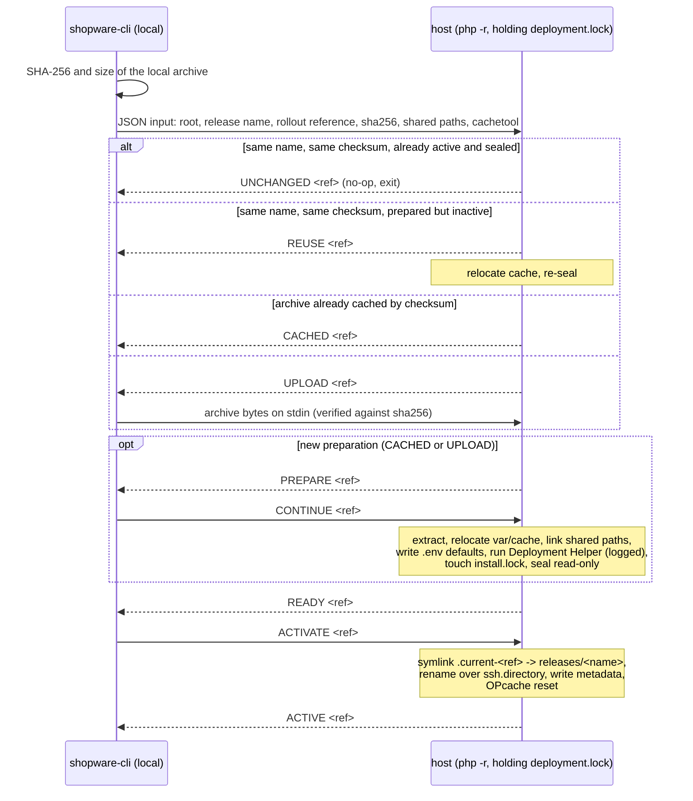

# Project deployment over SSH

`shopware-cli project deploy` builds an immutable deployment of a Shopware
project on your machine and rolls it out to one or more SSH hosts as a sealed
release behind an atomically switched symlink. Rolling back means pointing that
symlink at a release that is still on the host. This document explains the
workflow, what happens on the host, and the interfaces involved. It is accurate
to the current implementation (`internal/deployment/`,
`cmd/project/project_deployment*.go`, `internal/shop/config_ssh_*.go`).

> **Experimental.** The `deploy` command group is compiled only with the
> `deployment` build tag (`go build -tags deployment -o shopware-cli .`).
> Release binaries do not include it yet; `TestDeploymentCommandsDisabled`
> guards that. CI runs the command tests with `GOFLAGS=-tags=deployment`.

## TL;DR

- A **deployment** is a `tar.gz` built locally from a temporary copy of the
  project (`deploy create`). It gets a memorable name such as
  `focused-wise-turing` and lives in `.shopware-cli/deployments/`. Creating one
  never opens an SSH connection.
- A **rollout** uploads that archive (once; cached by checksum on the host),
  prepares a **release** directory, runs the Shopware Deployment Helper, seals
  the release read-only, and atomically switches the active symlink. Every
  activation gets its own rollout reference.
- `ssh.directory` is the **active symlink**, not a checkout. Its parent is the
  deployment root and holds `releases/`, `shared/`, `runtime/` and
  `.shopware-cli/`.
- **Rollback** switches the symlink back to a retained release. No upload, no
  helper run, no database rollback.
- Persistent data (`.env.local`, `files/`, `public/media`, ...) lives in
  `shared/` and is symlinked into every release. `var/cache` is per release and
  per host, under `runtime/`.
- Every remote operation runs under one lock, and the host only activates
  after the client explicitly says so. Failed preparations are kept for
  inspection; nothing is rolled back automatically.
- Multi-host groups are supported: Deployment Helper runs once on
  `migration_host`, every host prepares its own release, activation is
  sequential.

| Command | What it does |
| --- | --- |
| `deploy init` | Interactive one-time bootstrap of the host: writes `shared/.env.local` (database, URL, secret) and optional first-install values, then prints the next steps |
| `deploy create` | Build the project in a temporary copy and store `.shopware-cli/deployments/<name>.tar.gz`. `--rollout` continues straight into a rollout, `-o` picks a path, `--with-dev-dependencies` keeps dev packages |
| `deploy rollout [name]` | Upload, prepare, run Deployment Helper, seal, switch the symlink. Without a name, pick from local archives |
| `deploy rollback [name]` | Reactivate a release that is already on the host. Without a name, pick from remote candidates |
| `deploy list` | Successful rollouts, newest first, with the active one marked. `--format json` |
| `deploy logs <name>` | Stored Deployment Helper output of a release, including failed runs |
| `deploy prune` | Remove old releases, keeping the 5 most recently activated plus the active one. `--keep`, `--dry-run` |
| `deploy package archive` / `container` | The build pipeline alone: a `tar.gz` at any path, or Dockerfile generation. Nothing is uploaded |

Every command takes `-e <environment>` (the environment must be `type: ssh`;
the default `local` environment is refused) and `--project-config`.
`--no-interaction` skips confirmations and makes an explicit reference
mandatory; `deploy init` refuses to run without interaction.

## Workflow: from an empty server to a rollback

### 1. Describe the target in the project config

Add an SSH environment to `.config/shopware-project.yml` (schema:
`shopware-cli project config-schema`):

```yaml
environments:
  production:
    type: ssh
    url: https://shop.example.com
    ssh:
      host: shop.example.com
      user: deploy
      directory: /var/www/shop/live   # the active symlink; /var/www/shop is the deployment root
      php_binary: /usr/bin/php8.3     # optional, defaults to "php"
```

`directory` is an absolute path whose parent directory is dedicated to this
deployment. The link can have any name except `releases`, `shared`, `runtime`,
`.shopware-cli` or a `.current-` prefix. A real directory or file at that path
is never replaced, so adopting an existing checkout is a manual migration:
move its persistent data into `shared/` first.

The host needs SSH access, a PHP CLI and `tar` (`curl` with HTTPS as well when
CacheTool is enabled). The project must depend on `shopware/deployment-helper`
so the archive contains `vendor/bin/shopware-deployment-helper`; the rollout
refuses an archive without it.

### 2. Initialise the host once

```bash
shopware-cli project deploy init -e production
```

The command connects, inspects the deployment root (is there a `shared/`
directory, an active release, an existing runtime config, pending install
values?), and asks for:

- the application URL, prefilled from `url`;
- database credentials, either field by field or as one `DATABASE_URL`;
- optionally, values for a first installation (locale, currency, admin user,
  email and password, sales channel URL). Deployment Helper uses them only when
  it finds an uninstalled database.

After the final confirmation it writes `shared/.env.local` with `APP_ENV=prod`,
`APP_DEBUG=0`, `APP_URL`, `DATABASE_URL` and a generated `APP_SECRET` (unless
one already exists), mode `0600`, keeping any unrelated lines and comments.
First-install values go to `.shopware-cli/install.env`; the first successful
helper run deletes that file. Running `init` again offers to update the
existing configuration.

It ends with the exact next steps:

```text
Runtime configuration (add custom environment variables here):
  "shop.example.com": "/var/www/shop/shared/.env.local"
These files are shared by deployment releases.

Next steps:
  1. Ensure the configured database and database user exist and are reachable from the SSH hosts.
  2. Configure each web server's document root:
     "shop.example.com": "/var/www/shop/live/public"
     For a first deployment, this path becomes available during rollout.
  3. Build and deploy from your local machine:
     shopware-cli project deploy create -e 'production' --rollout -- '/path/to/project'
  4. Configure background workers and scheduled tasks to run from the active release path (ssh.directory).
  5. After rollout, open your application URL and verify the storefront and Administration.
```

`init` does not create the database or the user. It requires `.env.local` to be
one of the shared files (it is by default).

### 3. Build the first deployment locally

```bash
shopware-cli project deploy create -e production
```

The project is copied to a temporary directory without `.git`, `.env*` (except
`.env.dist` and `.env.example`), `var/`, `public/media`, `public/thumbnail`,
`public/sitemap`, `.shopware-cli/` and local config overrides. The normal CI
build runs there: Composer install without dev dependencies, extension asset
build, SBOM, and the `build:` hooks from the project config. The project config
inside the archive is reduced to its `deployment:` section, so API credentials
and `auth.json` never travel. Deployment Helper reads that section on the host,
so options such as `deployment.skip-assets-install` take effect during rollout. The result is hard-linked into place as
`.shopware-cli/deployments/<name>.tar.gz`; an existing archive is never
overwritten.

```text
Created deployment "focused-wise-turing"

Deploy it with:
  shopware-cli project deploy rollout -e 'production' 'focused-wise-turing'
```

Nothing has been uploaded yet. `--rollout` runs step 4 right away; if that
rollout fails or is declined, the archive stays for a retry. `-o path.tar.gz`
writes somewhere else; the printed reference is then that path, and `rollout`
accepts it as well.

### 4. Roll it out

```bash
shopware-cli project deploy rollout focused-wise-turing -e production
```

Before anything is sent, a preflight summary goes to stderr: the working
directory, project and config paths, environment, archive, and every SSH target
with host, user, port, active path, deployment root and role. Interactive
sessions then ask for confirmation. On the host, under the deployment lock:

1. upload the archive to `.shopware-cli/artifacts/<sha256>.tar.gz`, or skip the
   upload when an identical one is already cached;
2. extract it to `releases/focused-wise-turing/`;
3. move `var/cache` out to `runtime/focused-wise-turing/cache` and symlink it
   back into the release;
4. link every shared path into the release
   (`releases/focused-wise-turing/.env.local -> /var/www/shop/shared/.env.local`,
   ...);
5. write a minimal `.env` (`APP_ENV=prod`, `APP_DEBUG=0`) if the archive has
   neither `.env` nor `.env.dist`, so Symfony's dotenv cascade reaches
   `.env.local`;
6. run `vendor/bin/shopware-deployment-helper run --no-interaction` inside the
   release (migrations, plugin updates, theme compilation, first installation
   if `install.env` exists), streaming its output to your terminal and to
   `.shopware-cli/logs/focused-wise-turing.log`;
7. touch `install.lock` (in `shared/` by default);
8. make every file and directory of the release read-only;
9. switch `live` to `releases/focused-wise-turing` with an atomic rename;
10. reset OPcache if configured (see [CacheTool](#cachetool-and-opcache)).

On success the command prints `Deployed "focused-wise-turing" successfully`.
Point the web server document root at `/var/www/shop/live/public` and run
workers and cron from `/var/www/shop/live`.

### 5. Every later deployment

```bash
shopware-cli project deploy create -e production --rollout
```

Each archive gets a new name and each rollout a new release directory next to
the previous ones. Rolling out a name that is already active with the same
checksum is a no-op (`Deployment "..." is already active; nothing to do`). A
name that was prepared earlier but is inactive is reactivated without
re-running the helper. The same name with different archive contents is
rejected.

### 6. Rollback

```bash
shopware-cli project deploy rollback -e production
```

The picker lists releases retained on the host, newest first, with the active
one marked (`focused-wise-turing — created 2 hours ago (active)`); pass a name
to skip it. After the preflight summary and confirmation, the symlink is
switched to that release and a new activation is recorded. Nothing is uploaded,
extracted or migrated. Deployment Helper does not run again, so the code must
still work with the current database schema. Releases that failed, are
incomplete, were pruned, or are not sealed cannot be reactivated.

### 7. Housekeeping

```bash
shopware-cli project deploy list -e production
shopware-cli project deploy logs focused-wise-turing -e production
shopware-cli project deploy prune -e production --dry-run
```

`list` shows every successful rollout with its deployment name, status and
activation time; the JSON format adds the rollout reference as `release`.
`logs` prints the stored helper output, also for failed preparations.
`prune` keeps the 5 most recently activated distinct releases plus the active
one and removes the rest: release directory, runtime cache, metadata, logs and
cached archives that no retained record references. Failed, incomplete and
unmanaged releases are never removed. An interrupted prune is resumed on the
next run, even with a larger `--keep`.

## What lives on the host

```text
/var/www/shop/                               deployment root (parent of ssh.directory)
├── live -> releases/focused-wise-turing     ssh.directory, the active symlink (any name)
├── releases/
│   ├── focused-wise-turing/                 sealed, read-only
│   │   ├── .env                             generated defaults when the archive has none
│   │   ├── .env.local -> /var/www/shop/shared/.env.local
│   │   ├── public/media -> /var/www/shop/shared/public/media
│   │   ├── var/cache -> /var/www/shop/runtime/focused-wise-turing/cache
│   │   └── ...
│   └── clever-stoic-hopper/
├── shared/                                  persistent data, linked into every release
│   ├── .env.local                           written by deploy init (0600)
│   ├── install.lock
│   ├── config/jwt/  files/  var/log/
│   └── public/media/  public/plugins/  public/thumbnail/  public/sitemap/  public/theme/
├── runtime/
│   └── focused-wise-turing/cache/           writable cache, per release and per host
└── .shopware-cli/                           management state (0700)
    ├── deployment.lock                      flock held by init, rollout, rollback and prune
    ├── artifacts/<sha256>.tar.gz            uploaded archives, cached by checksum
    ├── releases/<name>.json                 release state: sha256, ready, reference, deployed_at
    ├── rollouts/<reference>.json            one record per activation: preparing | prepared | successful | failed
    ├── logs/<name>.log                      Deployment Helper output (0600)
    ├── install.env                          first-install values, deleted after the first successful helper run
    └── tools/cachetool-<version>.phar       verified CacheTool download, when enabled
```

Three identities are in play:

| Identity | Shape | Where it comes from |
| --- | --- | --- |
| Deployment name = release name | `[A-Za-z0-9][A-Za-z0-9._-]{0,127}` | archive basename without `.tar.gz`; generated as `<adjective>-<adjective>-<pioneer>` |
| Archive checksum | SHA-256 | computed locally before upload; a release is bound to it forever |
| Rollout reference | `<UTC timestamp>-<random>`, e.g. `20261028T101500Z-K7PQ2X...` | one per activation attempt, including rollbacks |

### Shared paths

Defaults: files `.env.local`, `install.lock`, `public/.htaccess`,
`public/.user.ini`; directories `config/jwt`, `files`, `var/log`,
`public/media`, `public/plugins`, `public/thumbnail`, `public/sitemap`,
`public/theme`. On a first rollout, a path that the archive contains but
`shared/` lacks is moved into `shared/`; a missing shared directory is created
empty; a missing shared file is simply not linked. Paths must be clean,
project-relative, must not overlap each other, and must not touch `var/cache`.
An explicit list replaces the defaults; `[]` disables that category.

## Rollout, step by step

The client is Go; the host side is a set of PHP scripts embedded in the binary
and executed with `php -r` over the multiplexed SSH connection, so the host
needs no installed agent. They talk a small line protocol on stdout, while all
human-readable progress and helper output goes to stderr. The client holds the
authority at every gate; if it disconnects or is cancelled, EOF on stdin
aborts without activating.



Metadata is written atomically (temp file plus rename) at each transition.
`rollouts/<ref>.json` moves `preparing` → `prepared` → `successful`, or to
`failed`. `releases/<name>.json` starts with `ready: false`, becomes `ready:
true` after sealing, carries `activation_pending` during the switch, and ends
with the rollout `reference` and `deployed_at`. `list`, `rollback` and `prune`
cross-check both files and refuse inconsistent state rather than guessing.

What happens when things go wrong:

- **Preparation fails** (extraction, a shared path conflict, Deployment Helper
  exits non-zero): the rollout record is marked `failed`, the release directory
  and its log stay for inspection, the lock is released, the active release is
  untouched. Retry with a new deployment name; a release with `ready: false`
  is refused for reuse.
- **Deployment Helper already ran migrations** before failing: the database is
  changed. This is not a database rollback mechanism.
- **Activation is interrupted**: the error names the active path to inspect
  before retrying.
- **OPcache reset fails** after the switch: only a warning; the activation
  stands.

## Rollback in detail

`rollback` is `ActivateDeployment` on a retained release:

- Candidates are directories under `releases/` whose release state and rollout
  record prove a successful, sealed activation with a known checksum. The
  picker and shell completion ask the host for them.
- Activation reuses the normal protocol from `REUSE` on: the release's runtime
  cache is verified, the release is confirmed sealed, a new rollout reference
  is recorded, the symlink is switched, OPcache is reset.
- An already active sealed release is a no-op. An active but writable release
  (one not created by this tool) cannot be hardened in place; deploy a new
  name instead.
- Pruned releases are gone; `prune` protects the active one but not the
  previous one unless it is within `--keep`.

## Configuration reference

All keys live under `environments.<name>.ssh`.

| Key | Meaning |
| --- | --- |
| `host`, `user`, `port`, `identity_file` | SSH transport. `user` and `port` fall back to `~/.ssh/config` and defaults |
| `directory` | Absolute path of the active symlink. Its parent is the deployment root |
| `php_binary`, `php_args` | PHP used for the embedded scripts, Deployment Helper and `cache:warmup` (for example `/usr/bin/php8.3`, `["-d", "memory_limit=512M"]`) |
| `shared.files`, `shared.directories` | Persistent paths linked into every release. Omit for the defaults above, give a list to replace them, `[]` to disable |
| `cachetool` | Opt-in OPcache reset after activation, see below |
| `hosts`, `migration_host`, `parallelism` | Multi-host groups, see below |

### CacheTool and OPcache

A sealed release behind a new symlink is invisible to a PHP-FPM process that
still has the old files in OPcache. Resetting that cache is opt-in:

```yaml
ssh:
  cachetool:
    enabled: true
    adapter: fcgi                 # or "web"
    fcgi: /run/php/php8.3-fpm.sock   # optional; omit for autodetection
    # fcgi_chroot: /srv/chroot
    # tmp_dir: /var/www/shop/tmp     # outside releases/ and the active symlink
```

| Key | Meaning |
| --- | --- |
| `enabled` | Default `false`. Validation of the other keys happens even when disabled |
| `adapter` | `fcgi` talks to PHP-FPM directly; `web` drops a temporary endpoint into `web_path` and fetches it via `web_url` |
| `fcgi`, `fcgi_chroot` | FastCGI socket or `host:port`, and the FPM chroot. `fcgi` adapter only |
| `web_url`, `web_path` | Both required for `web`. `web_path` must be an existing writable directory outside `releases/` and the active symlink; each run uses its own random subdirectory and removes it afterwards |
| `tmp_dir` | CacheTool temp directory, also outside releases and the active symlink |
| `config` | Path to a native CacheTool YAML on the host, targeting FPM or web (not CLI). Mutually exclusive with every inline key; its contents are not preflighted |

The pinned CacheTool PHAR (10.0.0) is downloaded once with `curl` into
`.shopware-cli/tools/`, verified against its SHA-256 before every run, and
executed with the configured PHP binary. The reset runs after the symlink
switch; a failure only warns.

If CacheTool is unset or disabled and the host's `hostname -f` contains
`de-nserver.de`, activation instead sends `SIGTERM` to every other PHP process
owned by the SSH user. That affects other shops or workers sharing the account
and is refused for `root`. Other hosts skip this step and log why.

### Multi-host groups

```yaml
environments:
  production:
    type: ssh
    url: https://shop.example.com
    ssh:
      user: deploy
      directory: /var/www/shop/live
      migration_host: web1
      parallelism: 2
      hosts:
        web1:
          host: web1.example.com
        web2:
          host: web2.example.com
          php_binary: /usr/bin/php8.3
```

- `host` and `hosts` are mutually exclusive. Host entries inherit `user`,
  `port`, `directory`, `identity_file` and `php_binary` from the common block
  and may override them; a `shared` or `cachetool` block on a host replaces
  the common one entirely.
- `migration_host` is required with more than one host. Two hosts must not
  resolve to the same host, user, port and directory. `parallelism` bounds
  concurrent host operations (default 2, maximum 32).
- `ssh.hosts` is deployment-only. Other SSH-backed commands (`project
  console`, database access, ...) still need a single `ssh.host`.
- The shared directories must be on a filesystem that every host sees, and
  must be provisioned before the first group rollout; the rollout refuses to
  create shared paths in a group. `releases/`, `runtime/`, the active symlink
  and `.shopware-cli/` stay host-local.

A coordinated rollout runs the same protocol on every host at once, held
together by the client:

1. **Stage** on all hosts in parallel: upload or reuse the archive, extract,
   relocate the cache, link shared paths. Each host holds its own lock and
   waits at `STAGED`.
2. **Prepare** the migration host alone: Deployment Helper runs there, once.
3. **Prepare** the followers in parallel: they run `bin/console cache:warmup`
   instead of the helper, then seal.
4. **Activate** one host at a time, in name order. A failure stops further
   switches; the error lists each host's state (`web1=activated,
   web2=failed activation; state unknown`). There is no automatic rollback
   across hosts.

`init` prompts once and writes through the migration host, then verifies by
hash that every host sees the same `shared/.env.local`. `rollback` requires
the release with the same checksum on every host. `list` adds a Host column,
`logs` reads from the migration host, and `prune` applies retention per host
and reports partial failures.

## Interfaces in Go

The command layer only knows `deployment.Backend`; everything else is an
optional capability discovered with a type assertion, so a backend without,
say, prune support fails with `ErrNotSupported` instead of a nil panic.

```go
// internal/deployment/deployment.go
type Backend interface {
    Type() string
    CreateDeployment(ctx context.Context, options CreateOptions) (Deployment, error)
    RolloutDeployment(ctx context.Context, deployment Deployment, output io.Writer) (Rollout, error)
}
```

| Capability interface | Method | Used by |
| --- | --- | --- |
| `Initializer` | `InitializeDeployment` | `deploy init` |
| `InitializationGuide` | `WriteInitializationNextSteps` | `deploy init` next-steps text |
| `CandidateProvider` | `RolloutCandidates`, `RollbackCandidates` | pickers and shell completion |
| `PreflightProvider` | `DeploymentPreflight` | preflight summary before rollout and rollback |
| `DeploymentActivator` | `ActivateDeployment` | `deploy rollback` |
| `RolloutHistory` | `ListRollouts` | `deploy list` |
| `DeploymentLogs` | `WriteDeploymentLogs` | `deploy logs` |
| `DeploymentPruner` | `PruneDeployments` | `deploy prune` |

Value types: `Deployment{Reference, Name}` identifies an artifact;
`Rollout{Host, Reference, Deployment, Active, DeployedAt, Unchanged}` is one
activation; `Candidate` adds `BuiltAt`, `CreatedAt`, `DeployedAt` and `Active`
for pickers; `Preflight` describes the resolved local source and remote
targets without connecting.

`deployment.New(root, configPath, cfg, env)` (`factory.go`) resolves the
environment: non-SSH types return `ErrNotSupported`, a single host yields
`*SSH`, and `ssh.hosts` yields `*sshGroup`, which implements the same
interfaces by fanning out over its members (`ssh_group*.go`) and delegating
local-only work (archive building, log reading) to the migration host.

The host side is PHP embedded with `go:embed` and composed per operation:

| Script | Role |
| --- | --- |
| `ssh_layout.php` | Prepended everywhere; resolves and validates the active-link path |
| `ssh_deployment.php` | Rollout, reactivation and rollback-candidate discovery; the protocol above |
| `ssh_permissions.php` | Runtime cache relocation, sealing and seal verification |
| `ssh_cachetool.php` | CacheTool download, verification and reset |
| `ssh_php_restart.php` | The `de-nserver.de` SIGTERM fallback |
| `ssh_deployment_init.php` | `inspect` and `apply` for `deploy init` |
| `ssh_deployment_list.php`, `ssh_deployment_logs.php`, `ssh_deployment_prune.php` | `list`, `logs`, `prune` |

Inputs are JSON (`sshRolloutInput` as a script argument; `init` reads JSON
from stdin); outputs are protocol lines or JSON on stdout, progress on stderr.
The Go tests exercise the real scripts against a local PHP where available.

## Design decisions and their trade-offs

| Decision | Why | Trade-off |
| --- | --- | --- |
| Build locally, ship an archive | The host needs only PHP and `tar`, no Git, Composer or Node; the artifact is reproducible and cached by checksum | Build time on the developer machine or CI runner; large uploads on the first rollout of each archive |
| Deployments are separate from rollouts | The same archive can be rolled out again, to another environment, or after a failed first attempt | Two commands for the common case (`create --rollout` collapses them) |
| Releases are sealed read-only, identified by checksum | A running release cannot drift; reuse and rollback are safe because the bytes are known | Extensions must write only to shared or `var/` paths; the file owner can still `chmod`, so separate deploy and runtime users are needed for real isolation |
| `var/cache` lives in `runtime/<name>/` per host | Caches are never shared across hosts or releases, and the sealed release stays immutable; a rolled-back release still has the cache it had when it was last active | Followers warm the cache during preparation, but a rollback never re-warms it |
| One lock, client-authorised gates | Two rollouts cannot interleave, and a dropped connection can never activate a half-prepared release (the kernel drops the `flock` with the process) | A second operator fails immediately with `Another deployment holds the lock` instead of queueing |
| Deployment Helper runs before activation, once | Migrations and plugin updates finish before traffic switches | A failed preparation may have migrated the database; code must stay schema-compatible for rollbacks |
| Sequential activation across hosts | Simple, observable, no distributed transaction | Not atomic: hosts can briefly serve different releases, and a mid-way failure needs manual inspection |
| OPcache reset is opt-in | Server setups differ; a wrong adapter must not break activation | Without it, stale OPcache can serve old code until FPM recycles; the only automatic fallback is provider-specific |
| Document root is `ssh.directory/public` | Web server config never changes between releases | Zero downtime still needs an application strategy: compatible migrations, worker restarts, OPcache |

## Known limitations

- Only the SSH backend exists. `local` and `docker` environments return
  `deployments are not supported`.
- No database rollback, and no automatic rollback across hosts.
- Adopting an existing non-managed checkout at `ssh.directory` requires moving
  its persistent data into `shared/` by hand first.
- Workers, cron and OPcache are not restarted for you except through the
  opt-in CacheTool reset or the `de-nserver.de` fallback.
- `deploy init` is interactive only; there is no flag-driven variant for CI.
